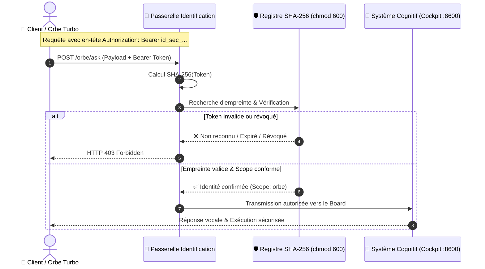

<div align="center">

# 🛡️ Identification Numérique Souveraine
### *Gestionnaire d'Identité Cryptographique, Jetons Zero-Trust & Contrôle d'Accès pour Systèmes Cognitifs & IA*

[](https://github.com/Turbo31150/identification-numerique)
[](https://github.com/Turbo31150/identification-numerique)
[](https://github.com/Turbo31150/turbo-os-boutique)
[](https://python.org)
[](LICENSE)

<br/>

> **La passerelle cryptographique souveraine qui protège votre infrastructure cognitive.**  
> Fini les fuites d'identifiants dans le Cloud ou les accès non contrôlés : délivrez des identités numériques éphémères, révocables et inviolables en temps constant.

---

</div>

## 📌 Sommaire
- [🎯 Vision & Problématique](#-vision--problématique)
- [✨ Les 4 Piliers de la Valeur](#-les-4-piliers-de-la-valeur)
- [🏗️ Architecture & Flux Cryptographique](#️-architecture--flux-cryptographique)
- [⚡ Démarrage Rapide (CLI)](#-démarrage-rapide-cli)
- [🔌 Intégration API & Agents (FastAPI / ASGI)](#-intégration-api--agents-fastapi--asgi)
- [💳 Modèle d'Abonnement & Monétisation (TTL)](#-modèle-dabonnement--monétisation-ttl)
- [🛡️ Spécifications de Sécurité](#️-spécifications-de-sécurité)

---

## 🎯 Vision & Problématique

Dans les architectures d'agents IA et de systèmes cognitifs actuels, deux vulnérabilités majeures compromettent les déploiements :
1. **La dépendance aux fournisseurs d'identité cloud tiers (Auth0, Okta, IAM US)** : Vos logs d'accès, jetons et flux de production transitent par des serveurs tiers, violant le secret d'affaires et la souveraineté des données.
2. **Le risque de RCE (Remote Code Execution)** : Sans passerelle stricte, un agent connecté au système d'exploitation peut être détourné à distance via des requêtes forgées.

**L'Identification Numérique Souveraine résout ce défi** : une infrastructure locale, imperméable et décentralisée, où chaque client ou agent s'authentifie via des jetons cryptographiques stricts à durée déterminée (TTL) et à périmètre délimité (Scopes).

---

## ✨ Les 4 Piliers de la Valeur

| Pilier | Description | Bénéfice Direct |
| :--- | :--- | :--- |
| 🛡️ **Zero-Trust Intégral** | Le serveur ne stocke **jamais** de clé secrète en clair, uniquement son empreinte **SHA-256**. | Même en cas d'accès physique à la base, impossible d'usurper un token. |
| ⏱️ **Cycle de Vie & TTL** | Chaque identité dispose d'une durée de vie (`30d`, `24h`, `7d`, `0`). | Expiration automatique des accès pour les formules par abonnement. |
| ⚡ **Vérification Constant-Time** | Comparaison cryptographique sécurisée contre les attaques temporelles (*timing attacks*). | Résistance native aux attaques de canaux auxiliaires. |
| 🎛️ **Granularité des Scopes** | Partitionnement strict des droits (`orbe`, `admin`, `api`, `*`). | Un agent de discussion ne peut jamais exécuter des commandes privilégiées. |

---

## 🏗️ Architecture & Flux Cryptographique



---

## ⚡ Démarrage Rapide (CLI)

### 1. Installation

```bash
git clone https://github.com/Turbo31150/identification-numerique.git
cd identification-numerique
pip install -e .
```

### 2. Commandes Utiles

* **Créer une identité pour un client (Abonnement 30 jours)** :
  ```bash
  identite create --label "client_acme" --scope orbe --ttl 30d
  ```

* **Créer un pass de démonstration (7 jours)** :
  ```bash
  identite create --label "demo_user" --scope orbe --ttl 7d
  ```

* **Auditer la liste des identités en cours** :
  ```bash
  identite list
  ```

* **Vérifier un jeton (ex: dans un script ou une passerelle)** :
  ```bash
  identite verify "id_sec_AbCdEf123456..." --scope orbe
  ```

* **Révoquer immédiatement un accès (Coupure instantanée)** :
  ```bash
  identite revoke id_a1b2c3
  ```

---

## 🔌 Intégration API & Agents (FastAPI / ASGI)

Protégez n'importe quelle route en 2 lignes de code avec le middleware natif :

```python
from fastapi import FastAPI, Depends
from identification_numerique.middleware import SovereignSecurityBearer

app = FastAPI(title="Sovereign Agent API")

# Protection stricte : scope 'orbe' requis, loopback autorisé pour les processus locaux
require_auth = SovereignSecurityBearer(required_scope="orbe", allow_loopback=True)

@app.post("/agent/execute", dependencies=[Depends(require_auth)])
async def execute_task(task: dict):
    return {"status": "success", "executed": True}
```

---

## 💳 Modèle d'Abonnement & Monétisation (TTL)

Ce gestionnaire d'identité constitue la colonne vertébrale des offres par abonnement de la boutique **Turbo OS** :

```
Formule Client         ➔  TTL Généré  ➔  Comportement
----------------------------------------------------------------------
Essai 7 Jours          ➔  ttl 7d       ➔  Coupure auto au 7e jour
Abonnement Mensuel     ➔  ttl 30d      ➔  Renouvellement par Stripe Webhook
Abonnement Annuel      ➔  ttl 365d     ➔  Actif 1 an
Révocation Directe     ➔  revoke <id>  ➔  Accès invalidé en < 1 ms
```

---

## 🛡️ Spécifications de Sécurité

* **Entropy** : Secrets générés via `secrets.token_urlsafe(32)` (256 bits d'entropie cryptographique).
* **Stockage** : Fichier d'identités protégé (`chmod 600`), permissions restreintes au propriétaire du processus.
* **Résistance aux failles** : Aucune transmission réseau hors du périmètre sécurisé, pas d'appels à des PKI externes non maîtrisées.

---

<div align="center">

Développé pour l'écosystème **[Turbo OS](https://github.com/Turbo31150/turbo-os-boutique)** · *Conçu en France pour la Souveraineté Numérique*.

</div>
